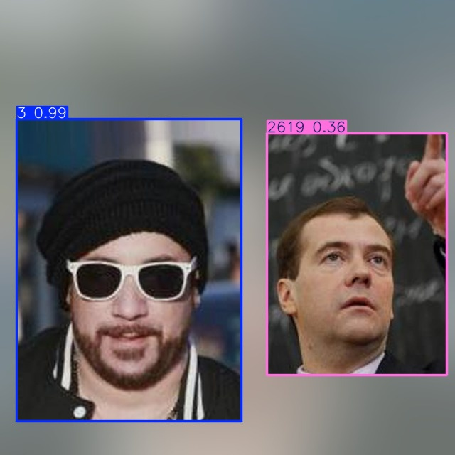
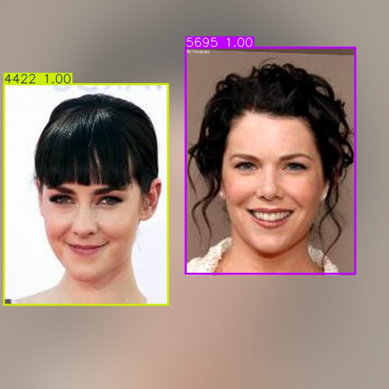
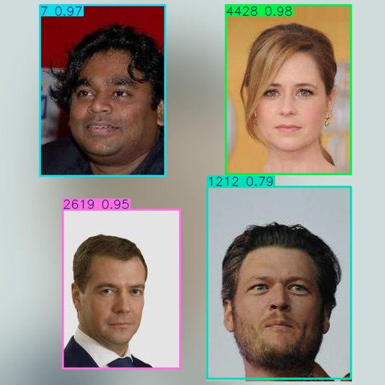
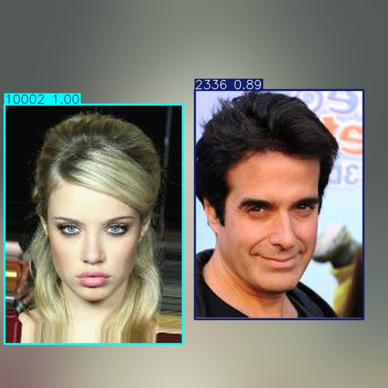
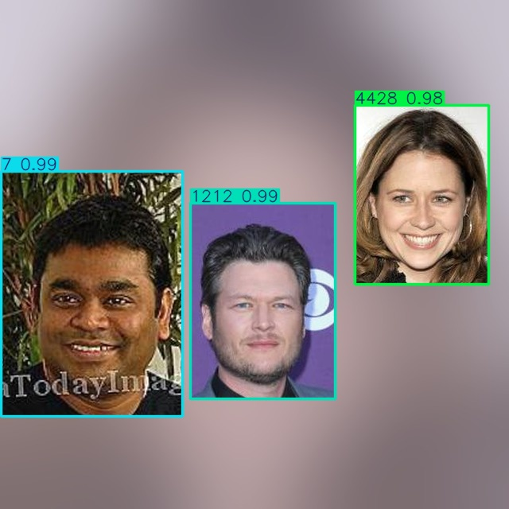
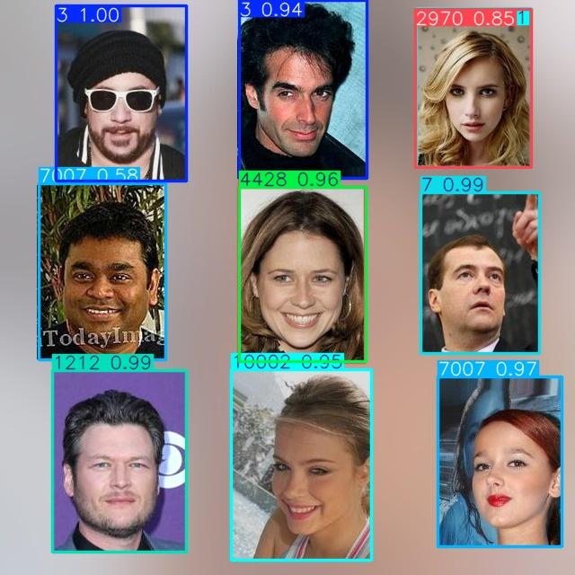
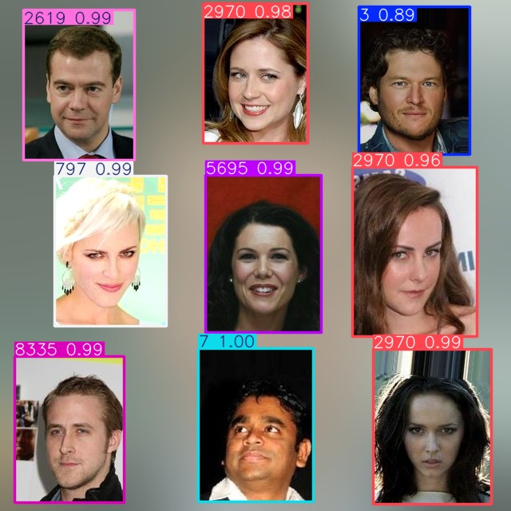
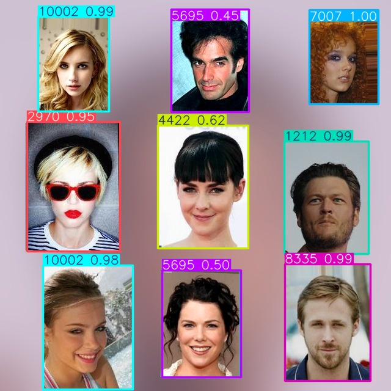
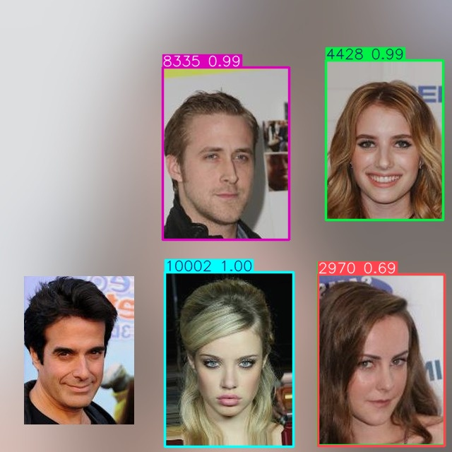
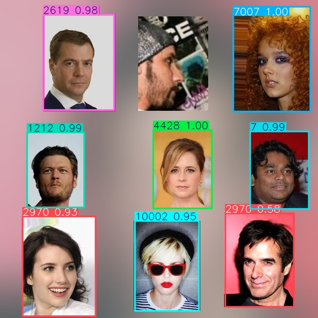

# Milestone 3 Detection Gallery

These ten examples were selected from the 39 held-out test frames. The first
five show fully matched identities; the next five illustrate missed, extra, or
confused predictions. The images show model-predicted boxes, identity IDs, and
confidence scores. Captions compare these predictions with the YOLO labels at
0.25 confidence and 0.5 matching IoU.

## Example 1: test_0020.jpg

2/2 identities matched; 0 missed, 0 extra predictions. Both portrait regions are correctly labeled, though the right-hand prediction has lower confidence (0.36).

## Example 2: test_0030.jpg

2/2 identities matched; 0 missed, 0 extra predictions. Both boxes follow the portrait regions closely and have high confidence.

## Example 3: test_0007.jpg

4/4 identities matched; 0 missed, 0 extra predictions. The detector identifies all four separated portraits.

## Example 4: test_0025.jpg

2/2 identities matched; 0 missed, 0 extra predictions. Both identities are assigned correctly despite different portrait sizes.

## Example 5: test_0021.jpg

3/3 identities matched; 0 missed, 0 extra predictions. All three portraits are localized and labeled with high confidence.

## Example 6: test_0009.jpg

6/9 identities matched; 3 missed, 5 extra predictions. Missed IDs: 2336, 2619, 7. Extra predicted IDs: 7, 3, 2970, 10002, 7007. Several boxes still follow the portrait regions, but their identity labels are wrong or duplicated.

## Example 7: test_0024.jpg

5/9 identities matched; 4 missed, 4 extra predictions. Missed IDs: 4428, 1212, 7007, 4422. Extra predicted IDs: 2970, 2970, 2970, 3. ID 2970 is repeatedly assigned to different portraits, illustrating identity confusion in a dense grid.

## Example 8: test_0019.jpg

6/9 identities matched; 3 missed, 4 extra predictions. Missed IDs: 797, 2336, 2970. Extra predicted IDs: 10002, 2970, 5695, 1212. Most portrait regions are located, while several identities are misassigned.

## Example 9: test_0003.jpg

2/5 identities matched; 3 missed, 3 extra predictions. Missed IDs: 4422, 2336, 2970. Extra predicted IDs: 4428, 2970, 4428. The lower-left portrait has no predicted box, and other regions receive incorrect identity labels.

## Example 10: test_0029.jpg

6/9 identities matched; 3 missed, 3 extra predictions. Missed IDs: 2336, 3, 797. Extra predicted IDs: 10002, 2970, 8335. One top-row portrait is not detected, and another portrait receives the wrong ID.
