# Milestone 4 final results gallery

Actual outputs of the validation-frozen M4 pipeline, all from the held-out test split. This curated gallery contains 20 correct single portraits spanning all 13 identities, all six misclassified test portraits, and ten multi-person predicted-box examples. Gallery curation does not change predictions, thresholds or reported metrics.

Single images are whole-portrait classification outputs; no estimated face box is claimed. Multi-person overlays show actual retained YOLO boxes and final identities. Green means localized and identity-correct, red means identity-wrong or unmatched. Missed objects remain in the captions. Visual observations below are hypotheses, not causal experiments.

## Single Correct

**3/003206.jpg (test).** True ID 3; predicted ID 3; classifier score 1.0000.

**7/022384.jpg (test).** True ID 7; predicted ID 7; classifier score 0.7836.

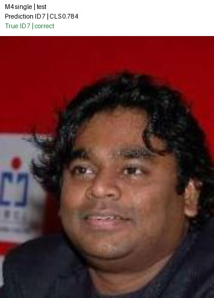

**797/169927.jpg (test).** True ID 797; predicted ID 797; classifier score 1.0000.

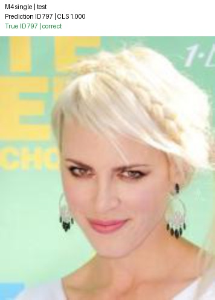

**1212/162783.jpg (test).** True ID 1212; predicted ID 1212; classifier score 0.9992.

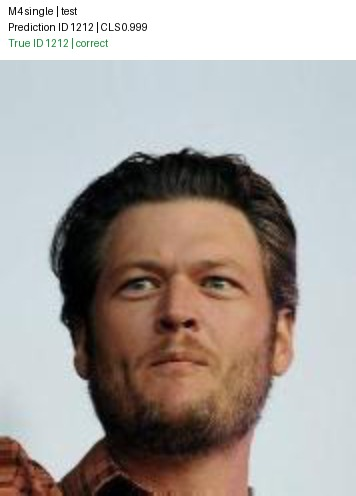

**2336/164885.jpg (test).** True ID 2336; predicted ID 2336; classifier score 0.9999.

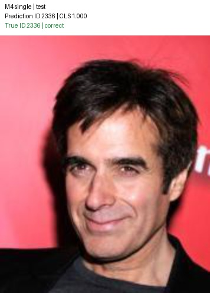

**2619/019964.jpg (test).** True ID 2619; predicted ID 2619; classifier score 1.0000.

**2970/018364.jpg (test).** True ID 2970; predicted ID 2970; classifier score 0.9914.

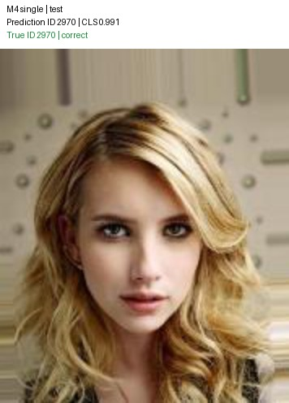

**4422/004354.jpg (test).** True ID 4422; predicted ID 4422; classifier score 1.0000.

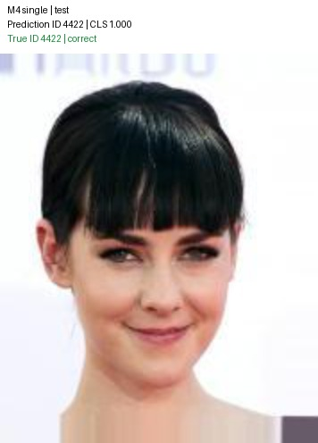

**4428/012582.jpg (test).** True ID 4428; predicted ID 4428; classifier score 0.9822.

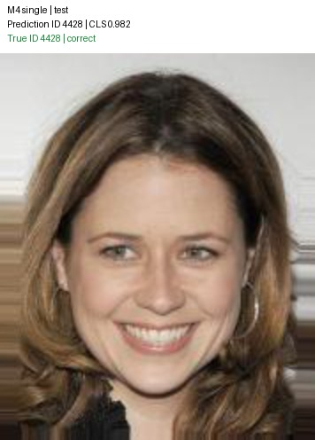

**5695/184773.jpg (test).** True ID 5695; predicted ID 5695; classifier score 0.6514.

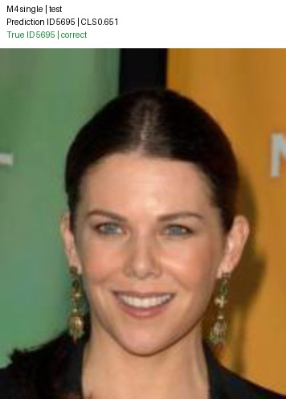

**7007/000491.jpg (test).** True ID 7007; predicted ID 7007; classifier score 0.9930.

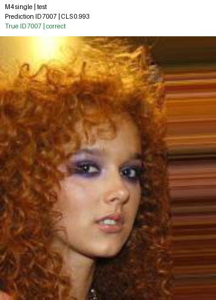

**8335/025296.jpg (test).** True ID 8335; predicted ID 8335; classifier score 0.9975.

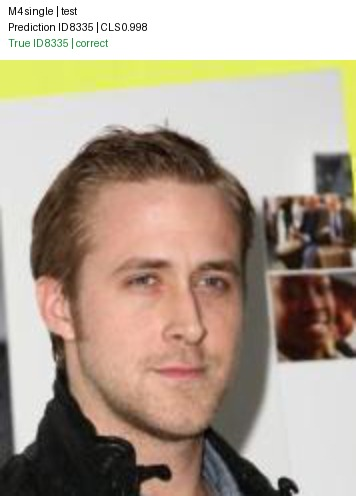

**10002/054636.jpg (test).** True ID 10002; predicted ID 10002; classifier score 0.9896.

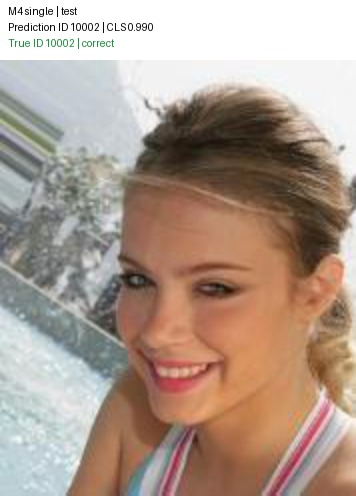

**3/043469.jpg (test).** True ID 3; predicted ID 3; classifier score 0.9994.

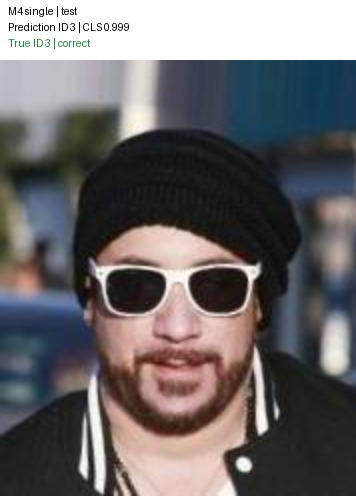

**7/063094.jpg (test).** True ID 7; predicted ID 7; classifier score 0.9660.

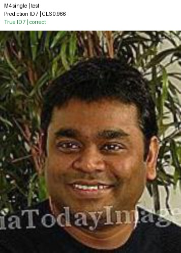

**797/170752.jpg (test).** True ID 797; predicted ID 797; classifier score 0.9697.

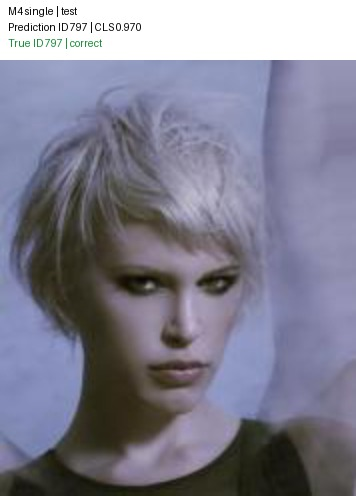

**1212/163499.jpg (test).** True ID 1212; predicted ID 1212; classifier score 0.9999.

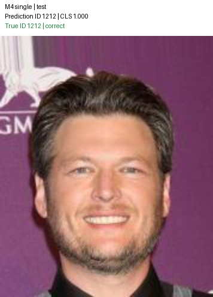

**2336/172736.jpg (test).** True ID 2336; predicted ID 2336; classifier score 1.0000.

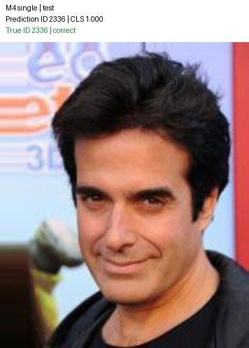

**2619/043824.jpg (test).** True ID 2619; predicted ID 2619; classifier score 0.9965.

**2970/053704.jpg (test).** True ID 2970; predicted ID 2970; classifier score 0.9993.

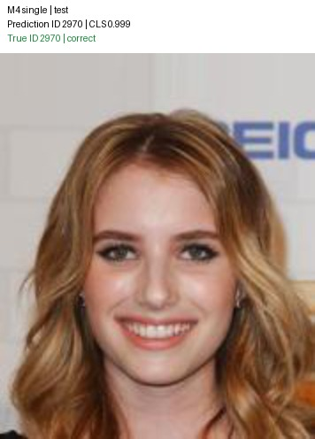

## Single Errors

**7/090356.jpg (test).** True ID 7; predicted ID 7007; classifier score 0.9538. True-ID probability: 0.037430. **Analysis:** The portrait has an upward gaze, warm illumination and limited fine facial detail. These are observable appearance differences; their causal contribution was not isolated. The same source is correctly identified in all four synthetic test occurrences, so this is input-format sensitivity rather than an unsupported identity.

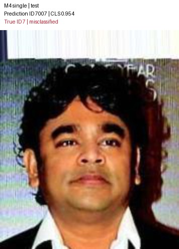

**797/164035.jpg (test).** True ID 797; predicted ID 4422; classifier score 0.8355. True-ID probability: 0.008357. **Analysis:** Large dark sunglasses cover the eyes, while a hat, bright lipstick and striped clothing occupy substantial image area. Eye-region occlusion is a plausible difficulty, not a proven cause. All three synthetic occurrences of this source are also misidentified.

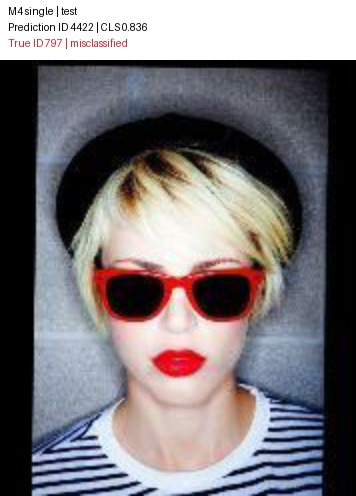

**4422/043327.jpg (test).** True ID 4422; predicted ID 2970; classifier score 0.9978. True-ID probability: 0.000056. **Analysis:** The face is in a three-quarter view with long hair; the eyes remain visible. The extreme wrong-class confidence shows that errors are not confined to visibly occluded faces. Pose and hairstyle variation are possible contributors, but no causal ablation was performed. All four composed occurrences also fail.

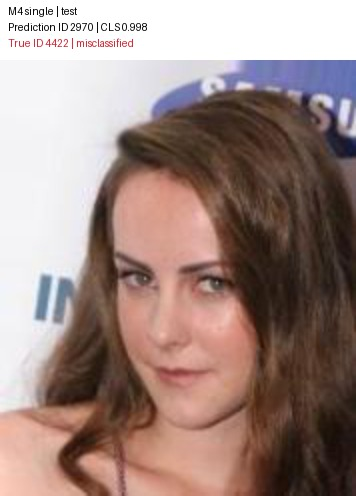

**4422/094334.jpg (test).** True ID 4422; predicted ID 7007; classifier score 0.9051. True-ID probability: 0.094824. **Analysis:** The head is tilted back with bright highlights near the eyes and a dark background. Pose and lighting variation are candidate explanations only. All three composed occurrences of the source are also misidentified.

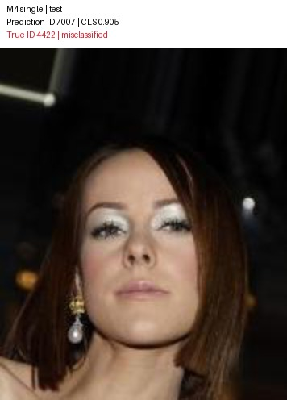

**10002/059390.jpg (test).** True ID 10002; predicted ID 4422; classifier score 0.9330. True-ID probability: 0.044686. **Analysis:** The face is largely frontal and unobscured, with styled hair and prominent eye makeup. The wrong prediction is confident despite clear facial visibility. The same source is correct in all four synthetic occurrences, suggesting sensitivity to cropping or appearance transformations; the responsible transformation was not isolated.

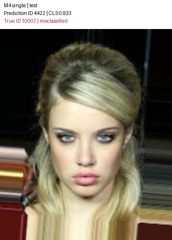

**10002/136320.jpg (test).** True ID 10002; predicted ID 2970; classifier score 0.5167. True-ID probability: 0.388759. **Analysis:** Light hair frames the face against a patterned red background. The true identity retains substantial probability, making this a relatively close ranking error. Background or appearance effects are hypotheses, not demonstrated causes. All three synthetic occurrences also fail.

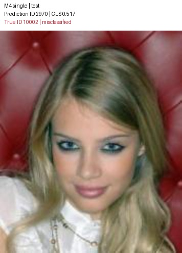

## Multi

**images/test/test_0000.jpg (test).** 2 labeled regions; 2 predicted boxes; 2 correctly localized and identified; 0 extra boxes. Missed IDs: none. Identity errors (true to predicted): none.

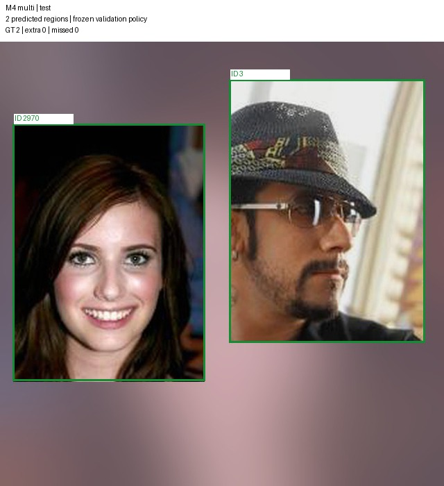

**images/test/test_0001.jpg (test).** 3 labeled regions; 3 predicted boxes; 3 correctly localized and identified; 0 extra boxes. Missed IDs: none. Identity errors (true to predicted): none.

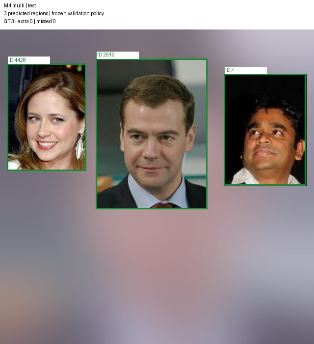

**images/test/test_0002.jpg (test).** 4 labeled regions; 4 predicted boxes; 4 correctly localized and identified; 0 extra boxes. Missed IDs: none. Identity errors (true to predicted): none.

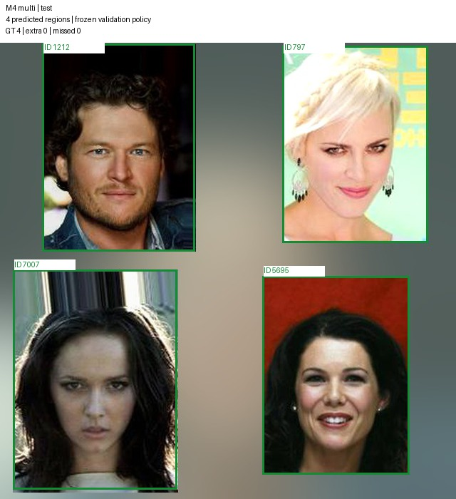

**images/test/test_0003.jpg (test).** 5 labeled regions; 4 predicted boxes; 3 correctly localized and identified; 0 extra boxes. Missed IDs: 2336. Identity errors (true to predicted): 4422 to 2970.

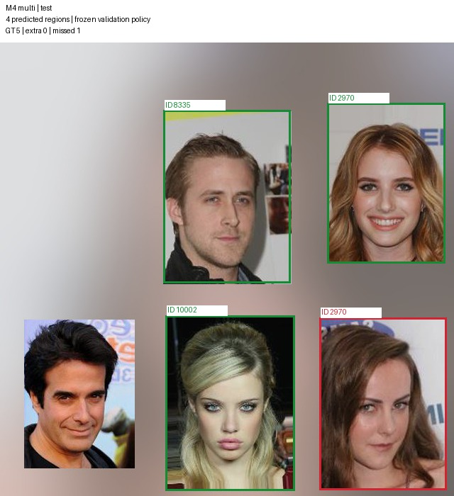

**images/test/test_0004.jpg (test).** 9 labeled regions; 9 predicted boxes; 8 correctly localized and identified; 0 extra boxes. Missed IDs: none. Identity errors (true to predicted): 797 to 10002.

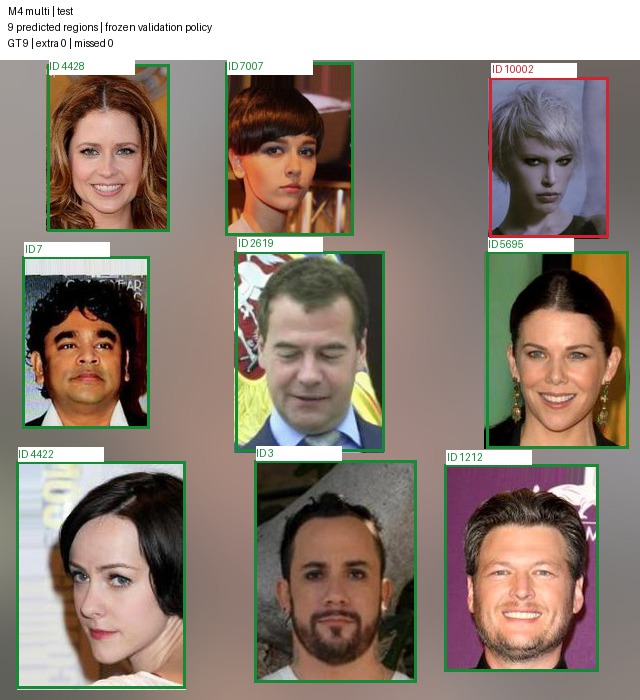

**images/test/test_0005.jpg (test).** 2 labeled regions; 1 predicted box; 0 correctly localized and identified; 0 extra boxes. Missed IDs: 8335. Identity errors (true to predicted): 10002 to 2970.

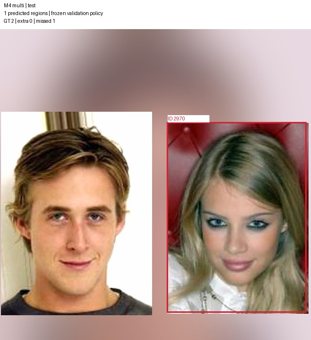

**images/test/test_0006.jpg (test).** 3 labeled regions; 3 predicted boxes; 3 correctly localized and identified; 0 extra boxes. Missed IDs: none. Identity errors (true to predicted): none.

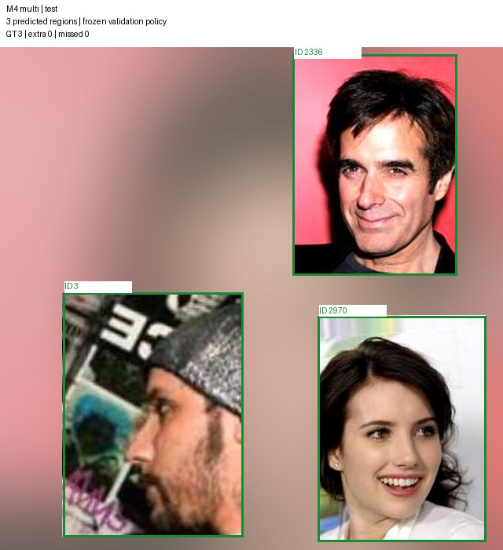

**images/test/test_0007.jpg (test).** 4 labeled regions; 4 predicted boxes; 4 correctly localized and identified; 0 extra boxes. Missed IDs: none. Identity errors (true to predicted): none.

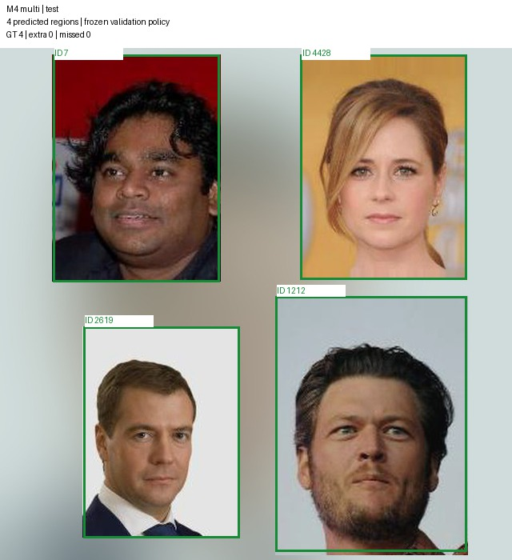

**images/test/test_0008.jpg (test).** 5 labeled regions; 5 predicted boxes; 4 correctly localized and identified; 0 extra boxes. Missed IDs: none. Identity errors (true to predicted): 797 to 4422.

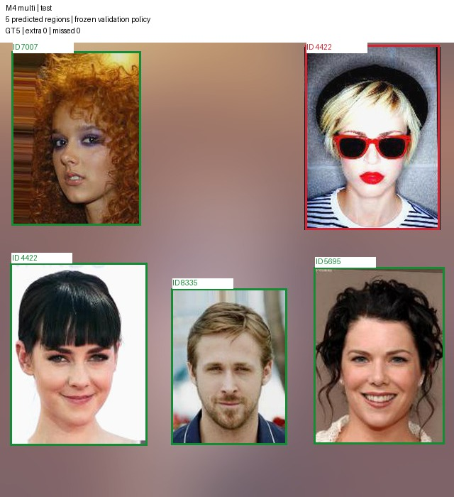

**images/test/test_0009.jpg (test).** 9 labeled regions; 9 predicted boxes; 8 correctly localized and identified; 0 extra boxes. Missed IDs: none. Identity errors (true to predicted): 7 to 7007.

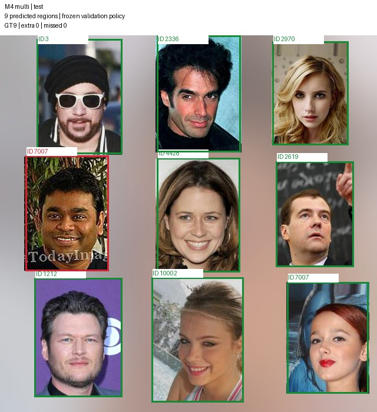

